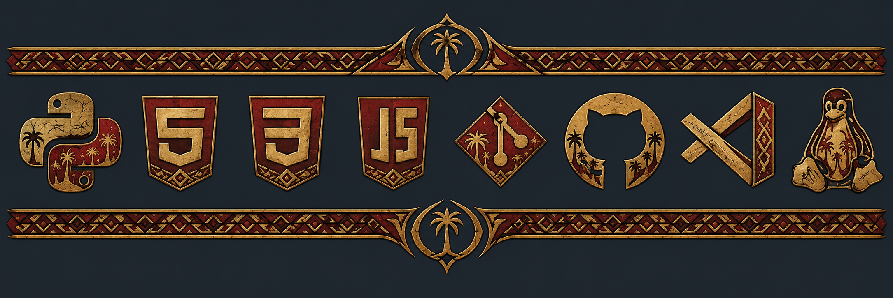

<!-- HEADER ANIMADO -->

<!-- TEXTO DIGITANDO -->

---

### ⚔️ Olá! Meu nome é Éder, também conhecido como Strow.

Sou um **Vibe Coder**, explorando o desenvolvimento de software através de inteligência artificial, criatividade e experimentação.

  

## 📜 Registros de desenvolvimento

 
<!-- SEQUÊNCIA DE CONTRIBUIÇÕES -->

  

<!-- CONTADOR DE VISITAS -->

  

